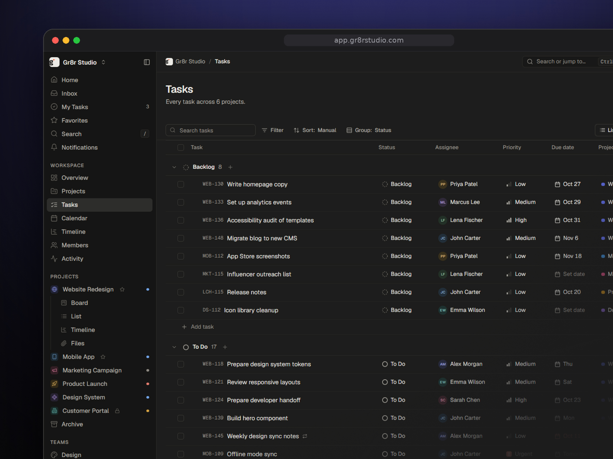
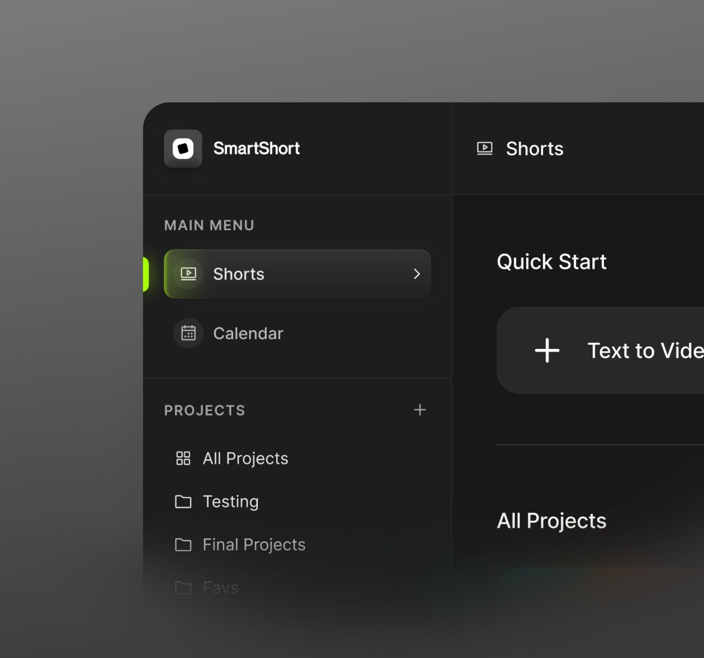
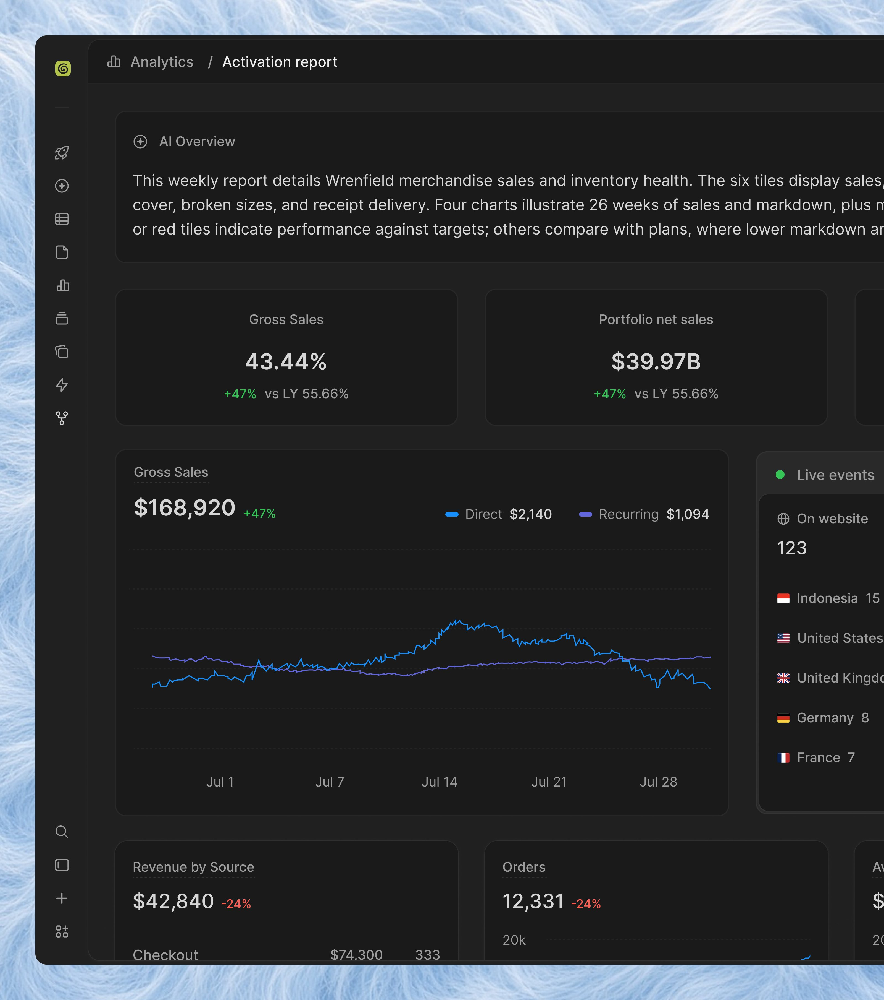

> Latest direction: read [Meta-first update](direction-update-meta-first.md). Earlier UI images are archival, not design targets; Meta is the first marketing integration.

# Reference index

## Owner-specified component roles

These roles come directly from Carter. Links received November 5, 2026; review is deliberately shallow.

| ID | Source | Intended role | Review status |
| --- | --- | --- | --- |
| L01 | [Skullet](http://skullet.lochie.me/) | Loading skeletons | Recorded as supplied; page could not be fetched |
| L02 | [Torph](http://torph.lochie.me/) | Text and number morphs | Landing page checked; demonstrates text morphing; numeric use needs a later prototype |
| L03 | [Liveline](http://benji.org/liveline) | Realtime charts | Official page checked; React animated live line chart |
| L04 | [visx](https://visx.airbnb.tech/) | Historical charts | Official landing URL resolved; detailed APIs not reviewed |
| L05 | [React Flow](https://reactflow.dev/) | Strategy diagrams | Official page checked; node-based UI building blocks |
| L06 | [Tailwind CSS](https://tailwindcss.com/) | Styling foundation | Official landing page checked |
| L07 | [shadcn/ui](https://ui.shadcn.com/) | Component foundation | Official landing page checked |

This is the proposed foundation plus focused tools, not a requirement to install every library. Prefer shared chart typography, formatting, colors, and tooltip behavior even when live and historical charts use different renderers.

## Component collections — inspiration pool

These are browse-on-demand sources, not additional mandatory frameworks. Suggested applications below are editorial proposals.

| ID | Source | Surface lightly checked | Possible Folio use |
| --- | --- | --- | --- |
| L08 | [SakaniUI](https://www.sakaniui.com/) | Components, product screens, charts, glass treatments | Screen composition, panels, selective surface detail |
| L09 | [Wensity UI](https://ui.wensity.com/components) | Text animation, cinematic interactions, AI interfaces, site blocks | Public-site motion and agent showcase treatments |
| L10 | [UIArc metrics dashboard](https://uiarc.dev/components/blocks/metrics-dashboard) | Exact page retained; fetch timed out | Metrics layout candidate; visual details unverified |
| L11 | [React Bits Pro — Application UI](https://pro.reactbits.dev/docs/app-ui) | Navigation, dashboards, AI agents, mobile, authentication categories | App shell, agent states, sign-in and mobile references |
| L12 | [Gauge UI](https://www.gauge-ui.dev/) | Composable React SVG gauges; shadcn integration shown | Agent budget, campaign pacing, or goal progress where a gauge improves reading |
| L13 | [mdxcn](https://www.mdxcn.dev/) | Markdown-friendly MDX components including timelines, tables and charts | Knowledge-base articles and embedded structured explanations |

## Supplied images

The following are direct observations and suggested applications, not confirmed preferences about every detail. Original source URLs and creators were not supplied; product names visible in an image do not establish authorship.

| ID / file | Visible qualities | Suggested application | Do not copy automatically |
| --- | --- | --- | --- |
| I01 — [Gr8r task workspace](assets/01-gr8r-task-workspace.png) | Dark neutral shell; grouped navigation; task toolbar; status groups; aligned metadata columns; restrained project colors | Projects/tasks workspace, campaign task lists, dense Founders desktop views | Deep navigation tree, monospace IDs, duplicate breadcrumb/title, very small text |
| I02 — [SmartShort navigation](assets/02-smartshort-navigation.png) | Large rounded shell; prominent active navigation row; lime marker and glow; roomy labels; clear section separation | Selection-state study and larger-target navigation; possible public showcase close-up | Lime brand color, glow, oversized rounding, uppercase section labels; these differ from current Founders rules |
| I03 — [Analytics dashboard](assets/03-analytics-dashboard.png) | Narrow icon rail; summary panel; KPI cards; wide line chart; live-events side panel; subtle borders | Marketing reporting, agent monitoring, realtime activity; desktop showcase composition | Icon-only navigation in Analog, low-contrast text, copied sample numbers, competing charts, positive coloring without metric context |

## Supplied videos

| ID | File | Original filename | Status |
| --- | --- | --- | --- |
| V01 | [Motion reference 1](assets/04-motion-yZGY4SDjI1vj4kQ9.mp4) | yZGY4SDjI1vj4kQ9.mp4 | Preserved; visual review pending |
| V02 | [Motion reference 2](assets/05-motion-YTFfPTkjsIU77xZi.mp4) | YTFfPTkjsIU77xZi (1).mp4 | Preserved; visual review pending |

Video source URLs, creators, and specifically favored moments have not been supplied. Do not infer exact easing or timing from still frames. Retain originals for playback and later motion selection.

Video metadata reports approximately 9.41 seconds for V01 and 49.98 seconds for V02. Local frame extraction could not decode either clip in this environment, so no claims about their visual content or animation style have been made. This is a review limitation, not evidence that the originals are damaged.
